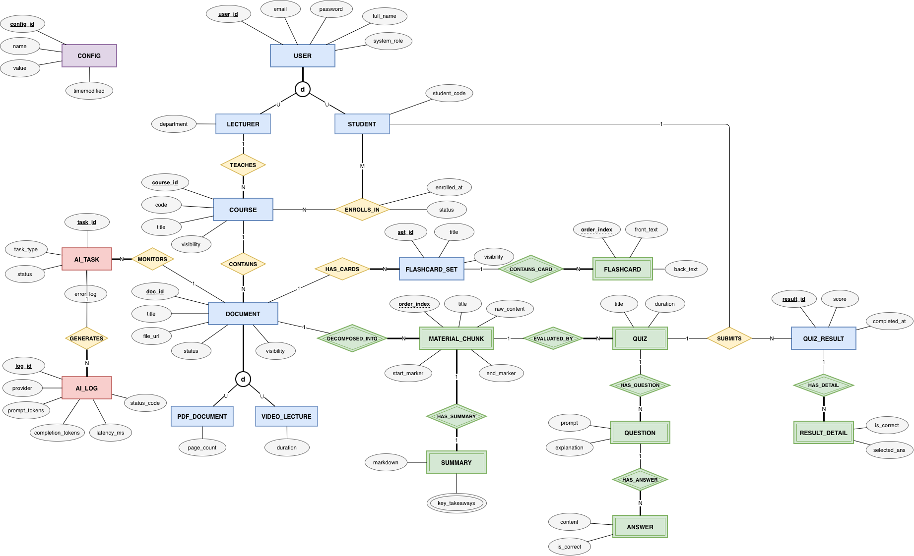

# Moodle Local Plugin: AI Micro-learning (`local_microlearning`)

An AI-enhanced Micro-learning plugin for Moodle LMS that transforms lecture documents (PDF/Video) into structured micro-content chunks, summaries, flashcards, and automated quizzes.

---

## 1. Directory Structure

```text
moodle-local_microlearning/
├── version.php                        # Plugin version and dependency requirements
├── README.md                          # Repository documentation
├── db/
│   ├── install.xml                    # XMLDB schema definition for 13 custom tables
│   ├── access.php                     # Capability permissions (RBAC) definition
│   └── services.php                   # External REST API functions registry
└── classes/                           # PSR-4 Autoloading namespace (\local_microlearning)
    ├── external/                      # External API Controllers (Request validation & DTO parsing)
    │   ├── material_api.php
    │   ├── ai_task_api.php
    │   ├── review_api.php
    │   ├── student_api.php
    │   └── quiz_api.php
    ├── services/                      # Business Logic Services
    │   ├── material_service.php
    │   ├── ai_orchestrator_service.php
    │   ├── review_service.php
    │   ├── student_service.php
    │   └── quiz_service.php
    └── repositories/                  # Database Access Repositories (Moodle $DB interaction)
        ├── material_repository.php
        ├── ai_task_repository.php
        ├── chunk_repository.php
        └── quiz_repository.php

```

> **Note:** The directory structure above illustrates the complete target architecture. In the current skeleton stage (`v1.0.0-skeleton`), components are being incrementally implemented.

---

## 2. Database Schema (13 XMLDB Tables)

The plugin initializes 13 custom tables prefixed with `mdl_local_microlearning_`:

1. **`docs`**: Source documents (PDF or Video lectures) metadata.
2. **`tasks`**: Asynchronous AI task execution states.
3. **`chunks`**: Content chunks segmented from source documents.
4. **`sums`**: AI-generated Markdown summaries and key takeaways per chunk.
5. **`fsets`**: Flashcard set groupings attached to documents.
6. **`fcards`**: Individual flashcard front/back concepts.
7. **`quizzes`**: Quizzes attached to individual content chunks.
8. **`quests`**: Multiple-choice questions and explanations.
9. **`ans`**: Answer options and correctness flags.
10. **`qres`**: Summary of student quiz attempts and scores.
11. **`rdet`**: Detailed answer selections per student attempt.
12. **`cfgs`**: System-wide configuration parameters and prompt templates.
13. **`logs`**: Operational execution logs for AI API calls, token usage, and latency.

### EERD



See [EERD Design](docs/eerd-design.md) for the schema mapping and
[API Contract](docs/api-contract.md) for the current endpoints.

---

## 3. Local Environment Setup

### Prerequisites
* **Moodle:** 4.0 or higher (`$plugin->requires = 2022041900`)
* **PHP:** 8.0 or higher (with standard Moodle extensions)

### Installation Steps

1. **Clone Repository:**
   Clone this repository directly into your local Moodle instance under the `local/` directory. Ensure the target directory name is strictly `microlearning`:
   ```bash
   cd /path_to_moodle/local
   git clone <REPOSITORY_URL> microlearning
   ```

2. **Initialize Database Schema:**
   * Log in to your local Moodle as an **Administrator**.
   * Navigate to **Site administration -> Notifications**.
   * Moodle will detect the plugin automatically and prompt you to upgrade. Click **Upgrade Moodle database now** to execute `db/install.xml` and generate the 13 required XMLDB tables.

---

## 4. Module Implementation Breakdown

### Module 1: Source Material & AI Task Management
* **Target Files:** `classes/services/material_service.php`, `classes/services/ai_orchestrator_service.php`
* **Scope:** Handle document upload validation, file deletion, dispatch processing jobs to the external AI Engine, and receive status callbacks via Webhooks.

### Module 2: Review Workspace (Human-in-the-Loop)
* **Target Files:** `classes/services/review_service.php`
* **Scope:** Provide endpoints for lecturers to review, edit, and curate AI-generated chunks, summaries, quizzes, and flashcards before publishing.

### Module 3: Student Feed & Assessment
* **Target Files:** `classes/services/student_service.php`, `classes/services/quiz_service.php`
* **Scope:** Deliver published micro-learning feeds to enrolled students, process quiz submissions, calculate scores, store detailed result histories, and generate analytics for instructors.

### Module 4: External AI Engine Worker
* **Scope:** Standalone Python microservice responsible for document parsing, chunking, LLM prompt orchestration, and returning JSON payloads to Moodle API endpoints.