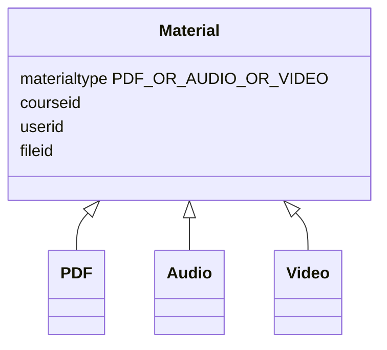
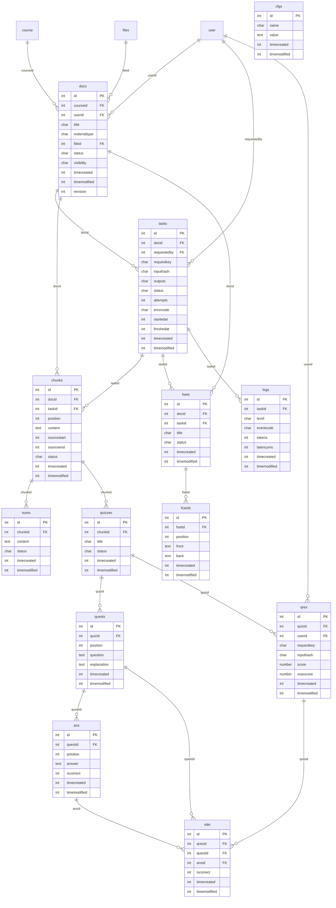

# EERD — AI Microlearning

The relational diagram maps directly to db/install.xml: thirteen plugin tables plus Moodle course/user/files. Moodle determines the actual database prefix; do not hard-code mdl_.

## Enhanced entity specialization

SOURCE MATERIAL uses total, disjoint specialization into PDF, AUDIO and VIDEO, implemented by docs.materialtype. All subtypes share ownership, tasks, chunks, quizzes and summaries. PDF uses parsing/OCR; AUDIO uses speech recognition; VIDEO extracts audio before transcription.

TODO: Validate supported discriminator values in services; the schema alone does not enforce this specialization.

## Relationships and keys

Unique constraints include one summary per chunk, a task request key per requester, a quiz submission key per user, positions within a task/set/quiz/question, and one answer detail per question/attempt.

TODO: Validate that ansid belongs to questid, questid belongs to the attempt's quiz, and the caller has course/resource access. Foreign keys alone do not enforce these business rules.

The diagram shows general relationship cardinalities. The proposed MVP uses one source file per document and File API cleanup on deletion. A document may have historical tasks, but only one may write output at a time. A chunk has at most one summary; the schema permits multiple quizzes, while the proposed MVP generates one quiz per chunk. Chunks store transcript text and source offsets rather than a separate transcript table. cfgs contains non-sensitive prompts/parameters; credentials belong in Moodle configuration.

## Team decisions and TODOs

- TODO: Confirm plugin-owned quizzes versus Moodle question bank/quiz activities. Gradebook integration is not implemented.
- TODO: Add flashcard access/review contracts if retaining the original thirteen-table scope; no dedicated flashcard endpoint exists yet.
- TODO: Agree on retention/privacy, AI/OCR/ASR providers and source limits.
- TODO: Update this model before adding scripts, voice profiles, generated speech or library/search modules.
