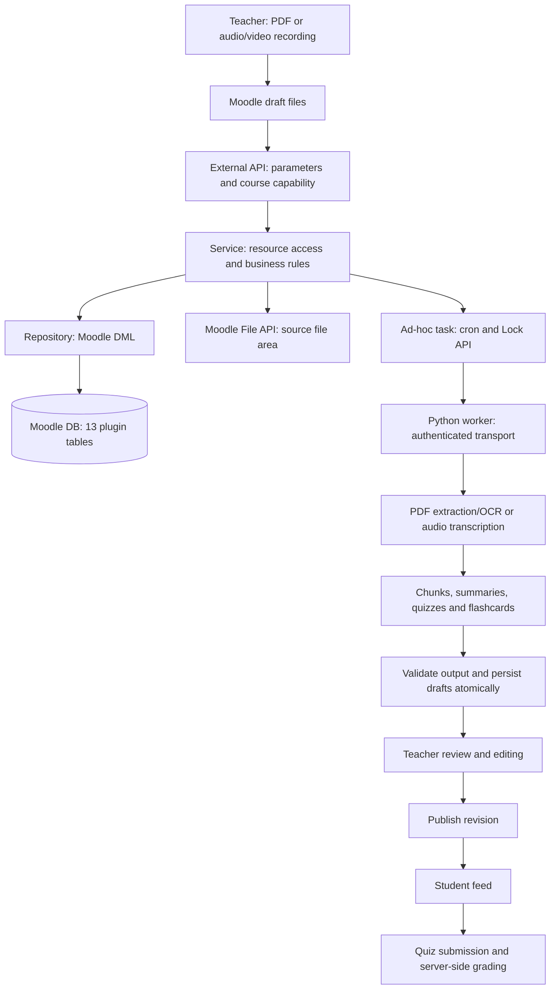

# System Architecture

Assessment date: 2026-10-28. Baseline: README and commit `106acba` on main. The baseline repository did not contain a separate system architecture document. This document describes the proposed implementation, not a completed application.

## Implementation status

The baseline had seven source/documentation files, two registered API controllers that did not exist, and no install.xml despite describing thirteen tables. The current scaffold provides a schema, API contracts, controllers, service/repository stubs, an ad-hoc task, and a documented external-engine integration contract.

Controllers validate parameters and course capabilities, then call services that deliberately throw `notimplemented`. No AI workflow is implemented. PHP/Moodle runtime validation is still required.

## Proposed flow

The scaffold proposes an ad-hoc task calling the worker and receiving its result. The original README describes webhook callbacks; transport selection remains a team decision. TODO: Select authenticated request/response, job polling, or callbacks and update the contract before implementation. AI must not run in the upload request or inside a database transaction.

A recording means an existing MP3/WAV/M4A/WebM source file. Browser recording is a future UI task: upload the resulting Blob through Moodle's draft area and reuse the AUDIO workflow. Scanned PDFs require OCR or an explicit unsupported/no-text error. VIDEO requires audio extraction before transcription.

## Service implementation requirements

- TODO: Accept draftitemid rather than arbitrary paths or URLs. Check ownership, a single source file, extension/MIME/content, size and duration. Proposed limits for team review: 20 MiB PDF, 100 MiB audio, 60 minutes audio. Store files under component `local_microlearning`, area `source`, itemid=docid and course context. Implement an authorised pluginfile callback; never persist public source URLs or tokens.
- TODO: Resolve every task/chunk/quiz to its document and course. Restrict drafts/private material to the uploader or reviewer; restrict CLASS_ONLY content to authorised course users. PUBLIC access is outside the proposed MVP.
- TODO: Implement task states QUEUED -> RUNNING -> SUCCEEDED/FAILED with locking, timeouts and bounded retries. Reuse requestedby/requestkey when the canonical inputhash matches; otherwise reject the conflict. Allow only one output-writing task per document.
- TODO: Implement document states READY -> PROCESSING -> REVIEW -> PUBLISHED, with FAILED on processing errors. Save/publish must compare and increment revision. Publish all content atomically. Do not regenerate published material with existing attempts; create a new document.
- TODO: Validate parent-child ownership, task.docid/chunk.docid consistency, positions and source offsets. PDF offsets are inclusive 1-based pages; audio/video offsets are milliseconds [start,end). XMLDB foreign keys do not replace application validation or guarantee physical FK enforcement on every database.
- TODO: Enforce single-choice quizzes: at least two options and exactly one correct option per question. Grade in Moodle, hide correctness/explanations before submission, and write attempts/details atomically with request-key idempotency. Freeze content with existing attempts.
- TODO: Filter rendered Markdown with Moodle APIs. Treat model output and source content as untrusted data. Use authenticated source transfer; do not fetch arbitrary user URLs. Keep credentials in administrator configuration and exclude secrets/raw source text from logs.
- TODO: Block deletion of material with student attempts. Delete unpublished children and source files consistently. Implement privacy export/deletion and retention policies before using real user data.

## Installation and compatibility

The target minimum is Moodle 4.0, using `externallib.php` and legacy `external_api`. Table names remain within the older 28-character limit. References: [External API](https://moodledev.io/docs/4.5/apis/subsystems/external), [XMLDB editor](https://moodledev.io/general/development/tools/xmldb).

Install in `moodle/local/microlearning` and run Notifications/CLI upgrade on a test site. The upgrade script targets the original skeleton without tables. Manually created tables require an explicit schema comparison/migration. REST service access is disabled/restricted by default; AJAX still requires Moodle session and capability checks.

TODO: Verify fresh installation, upgrade, API registration, capabilities, cron execution and file access on the team's Moodle/PHP environment.
